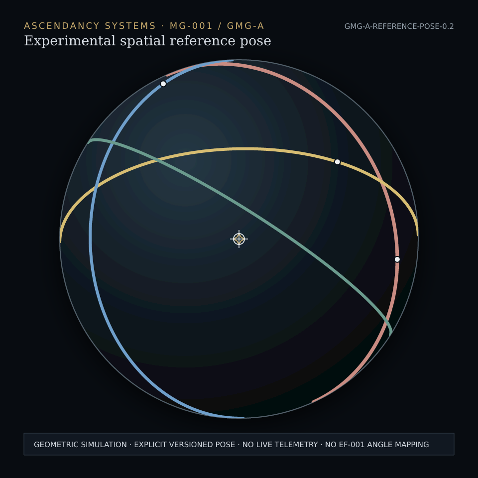

# Meta-Gauge

Public research prototype for **MG-001**, the registered Ascendancy Systems Meta-Gauge, and **GMG-A**, its experimental gyroscopic/spatial implementation.

**Status:** the public GMG-A viewer remains the v0.2 geometric demonstrator. Working Draft v0.4, the Gate A verification contract, and the isolated Gate B simulation have been reviewed and merged. Gate C is the next technical development gate. See the [development status](./docs/development-status.md).

[Open the public v0.2 viewer](https://ascendancy-systems.github.io/meta-gauge/) · [Specification index](./specifications/README.md) · [Gate B laboratory and local run instructions](./experiments/gate-b/README.md) · [Front Desk](https://ascendancy-systems.github.io/front-desk/)

[Working Draft v0.4](./specifications/MG-001_GMG-A_Dual_Instrument_Working_Specification_v0.4.md) describes the dual-instrument design. Its supporting material includes the [mathematical notes](./docs/MG-001_GMG-A_mathematical_notes_v0.4.md), [visual atlas](./docs/visual-atlas/v0.4.md), and [Gate A state and verification contract](./docs/MG-001_GMG-A_gate_a_contract_v0.4.md). The [Gate B snapshot](./experiments/gate-b/snapshot.svg) shows the default laboratory scene.

The [MG-001 operational record](https://github.com/Ascendancy-Systems/.github/blob/main/profile/META-GAUGE.md) contains EF-001, a bounded qualitative assessment of one public research-orientation statement. Gate B represents simulated toroidal and spatial states. Neither provides a validated quantitative measurement of Ascendancy’s research program. The possibility of a general-purpose Meta-Gauge family is under consideration, with Ascendancy-specific measurement models as one possible application. The registered instrument and institutional identities retain their current definitions.



## What works

Public v0.2 demonstrator:

- Four independently posed ring planes are projected from a three-dimensional world model.
- Far-side arcs are concealed by the spherical front-hemisphere projection.
- Camera motion is independent of instrument state.
- Ring-attached markers follow their owning frames.
- A reference-independent observer reticle can be moved by pointer, touch, keyboard-accessible sliders, or a center command.
- The static SVG/PNG and browser demonstrator consume the same explicit pose and projection in [`config/gmg-a-reference-pose-v0.2.json`](./config/gmg-a-reference-pose-v0.2.json).
- Geometric tests cover camera invariance, far-side occlusion, marker phase, and static/demo state identity.

Isolated Gate B laboratory:

- A selected Y simulation sample drives both dial phases and the full trial GMG-A attitude. The camera, ring marker phases, and qualitative assessment record retain separate state.
- The lab has an observer-center reference and explicit world and ring-marker targets. An occluded target retains its identity while its pointer is hidden.
- The local interactive view and the reference SVG share the same versioned fixture and render code for the default scene.

## What is simulation only

- Ring manipulation and the reference preset demonstrate simulated motion.
- Colors distinguish prototype components; they do not encode ratified research domains.
- Angle readouts measure relationships between geometric planes only.
- The free-aim reticle reports azimuth and elevation relative to the observer. Changing aim leaves the ring poses and camera untouched.

## What is not implemented or calibrated

- No EF-001 state is converted into an angle, pose, speed, or target.
- No live telemetry is present.
- The public v0.2 viewer retains free aim. Gate B's world and ring-marker locks are available in the local laboratory. Two-target comparison remains proposed.
- Historical orientation terms—Proper, Anti, Anmti, Amnti, and Anmnti—have no assigned colors, angles, or mechanics.
- The original GMG-A v0.1 artifacts remain pending recovery. See [artifact provenance](./docs/artifact-provenance.md).

## Project map

| Path | Purpose |
|---|---|
| `index.html` | Accessible interactive demonstrator |
| `src/geometry.mjs` | Shared spatial mathematics and projection |
| `src/app.mjs` | Browser controls and canvas rendering |
| `config/gmg-a-reference-pose-v0.2.json` | Versioned reference pose and camera projection |
| `scripts/render-static.mjs` | Deterministic SVG generator from the same state |
| `assets/` | Generated reference SVG and mobile-compatible PNG |
| [Specifications](./specifications/README.md) | Spatial v0.2, historical dual-instrument v0.3, and current Working Draft v0.4 |
| [Gate B laboratory](./experiments/gate-b/README.md) | Local dual-view simulation and reproducible reference snapshot |
| [Development status](./docs/development-status.md) | Gate history, Gate C scope, and measurement and release boundaries |
| [Artifact provenance](./docs/artifact-provenance.md) | Recovery status for the original v0.1 artifacts |
| `tests/` | Geometry, occlusion, marker, and consistency tests |
| [Reference-plane snapshots](./snapshots/reference-plane-crossing/) | The [observer-pitch test](./tests/reference-plane-transition.test.mjs) explains why the visible arc changes when the observer crosses the plane. |

## Run locally

The demonstrator has no runtime dependencies. Serve the repository over HTTP, then open the local URL in a browser. The viewer fetches the pose JSON and loads JavaScript modules over HTTP.

```text
python -m http.server 8000 --bind 127.0.0.1
```

Open [v0.2 locally](http://127.0.0.1:8000/) or the [local Gate B laboratory](http://127.0.0.1:8000/experiments/gate-b/). For checks, run `npm ci --ignore-scripts` and `npm run check` from the repository root. The [Gate B notes](./experiments/gate-b/README.md#reproduce) describe snapshot regeneration and the optional browser checks.

## Updating the reference pose

Edit the [versioned pose](./config/gmg-a-reference-pose-v0.2.json). The browser reads it directly. The static renderer uses the same geometry to produce the SVG, and the [organization profile](https://github.com/Ascendancy-Systems) displays a PNG rendered from that SVG.

From the repository root, install the locked development tools and regenerate both images.

```text
npm ci --ignore-scripts
npm run render:pose
```

Review the viewer and the PNG side by side. Stage the pose and both reference images together, then run `npm run check`. Pull requests and Pages deployments run the same check. It regenerates the SVG and checks the PNG byte for byte using the locked renderer and fonts.

GitHub Pages stages the v0.2 browser entry point, its JavaScript, and its pose file. The [Pages workflow](./.github/workflows/pages.yml) leaves the Gate B laboratory, specifications, and tests outside that deployment.

## Bounded next steps

**Gate C** covers simulated trajectories, validated D1/D2, declared time bases and reference frames, missing-data behavior, and reticle semantics. **Gate D** requires a separately reviewed measurement model before any quantitative assessment. **Gate E** covers public integration and release review. The current scope is repository documentation and local simulation. See the [gate record](./docs/development-status.md).

No license is granted by omission; publication here is for public inspection and research prototyping until Ascendancy Systems selects an explicit license.
