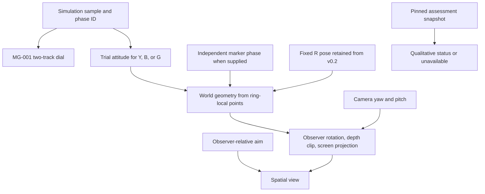
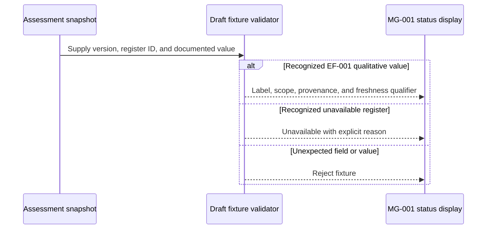

# MG-001 / GMG-A · Gate A state and verification contract

Companion to [Working Draft v0.4](../specifications/MG-001_GMG-A_Dual_Instrument_Working_Specification_v0.4.md). The envelope version is **mg001-gmga-draft-0.4.1**. Its executable reader is an isolated design fixture. The spatial v0.2 state and renderer retain their own version and formats.

## Records and authority

| Record | Identity and fields | Permitted use |
| --- | --- | --- |
| Simulation | Model and adapter IDs, twist off, samples with unique IDs, Y/B/G channel, finite seconds, phase pair in radians in $[0,2\pi)$ | Two-track dial and full spatial attitude. Use the same selected sample and version in both views. |
| Assessment snapshot | Pinned public source revision and four stable MG-001 register IDs | Qualitative status or unavailable reason. No numeric geometry fields are accepted. |
| Viewer | Selected sample ID or null, finite yaw and pitch in degrees | Selection and projection. The camera never becomes an input to the dial or trial attitude. |

The [JSON fixture](../tests/fixtures/v04-dual-view.json) places two arbitrary simulated Y samples beside all four registers. Its EF-001 fields reproduce the public signal metadata and bounded finding. The review freshness field is unverified in this exercise. It adds no assessment and confers no publication authority. A stale record retains its historical qualifier and gets an explicit stale label. A missing, invalid, or unassessed register is unavailable with its reason visible. An absent selection produces null for both simulated outputs while status remains present. Simulation seconds and the EF-001 assessment date are separate clocks.

**DG-03 · Record and frame boundaries.** Arrows describe inputs to the proposed views. The observer rotation applies after ring-local coordinates have been placed in the world. The free-aim reticle is observer-relative. Ring- and world-locked reticles would need their own persistent target and attachment identity.

**DG-04 · Assessment handling.** The fixture validator checks structure and the explicit EF-001 values. The operating record governs the actual assessment. A future loader must verify source revision and freshness according to an approved policy before using a record. This fixture supplies no general-purpose authorization or evidence evaluator.

## Numeric failure behavior

The interval fixture supports exact endpoints, a finite nonnegative rate bound, and a finite positive maximum gap, all in declared seconds and radians. It requires a strictly increasing pair of timestamps within that gap. At and above the half-turn bound it suppresses the rate even when the two wrapped observations happen to coincide. Below that bound, it checks consistency of the observed shortest step with the bound. A positive maximum step allows a floating-point roundoff margin of $8\pi\epsilon_{\rm machine}$. A zero maximum step requires zero displacement at the represented precision. Invalid data, missing rate bounds, and gaps return a null rate with a reason. A validated stationary step returns numeric zero. The general endpoint-error treatment is in the [mathematical notes](./MG-001_GMG-A_mathematical_notes_v0.4.md#dyn-01--num-01--connections-sampling-and-uncertainty).

The trial attitude output exposes the whole matrix. It does not infer a local marker phase or reticle target. The existing fixture supplies independent local marker phases for its own scene. Any Gate B demonstrator should make its marker policy explicit before attempting round-trip inspection.

## Acceptance matrix

| Requirement | Check | Where it is resolved |
| --- | --- | --- |
| State and evidence coexist without cross-coupling | Select both Y samples, move the camera, clear selection, simulate stale and missing evidence, and reject numeric evidence fields and unauthorized R coupling. | [State contract tests](../tests/v04-state-contract.test.mjs) |
| Real zero is distinct from missing, ambiguous, or invalid | Test the seam, exactly half a turn, missing/non-finite values, reversed and duplicate times, a gap, and an inconsistent bound. | [State contract tests](../tests/v04-state-contract.test.mjs) |
| The adapter uses the declared rotations and the derivative models differ | Compare with v0.2 rotation primitives, project finite-difference ambient acceleration to the torus tangent basis, and vary yaw for a stationary world point. | [Dynamics tests](../tests/v04-dynamics.test.mjs) |
| Reproducibility and preservation | Run the existing checks, rebuild the atlas byte for byte, and preserve the existing reference SVG and PNG. | [Atlas](./visual-atlas/v0.4.md) and repository CI |
| Perceptual validation and empirically governed mapping | Review actual client behavior when a demonstrator exists. For calibration predeclare the target, metric, baseline, independent validation set, acceptance threshold, missing-data rules, and approval authority. | Gates B–E, pending |

## Decisions carried forward

Gate B can test the simulation with both complete phase tracks and full attitude, preserving the locked R ring and existing deployment. Before a viewer implementation is reviewed, specify independent marker phase, shared sample selection, and static/interactive agreement. A rendered frame diagram can then document actual reticle attachments. A twisted-fiber illustration can accompany an opt-in simulation if that mode is selected. A governed calibration or quantitative research mapping requires a justified target, independent evidence, and approval. The exact simulation estimator above supplies none of those operational parameters.
