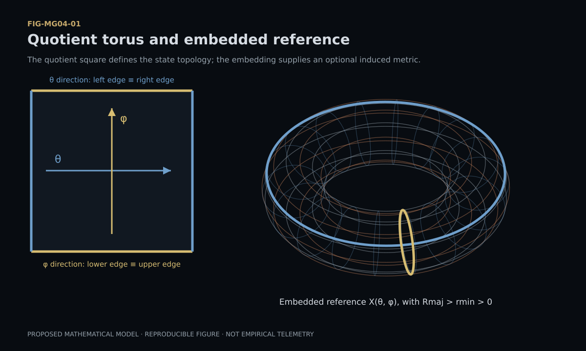
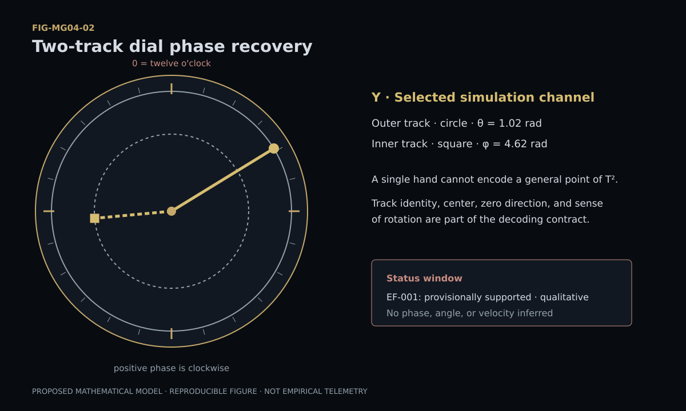
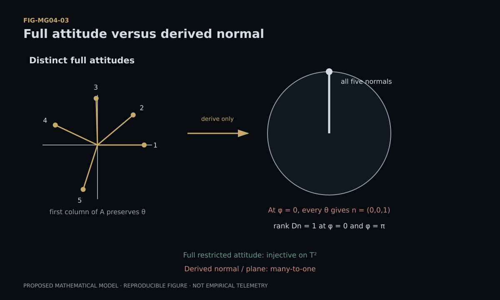
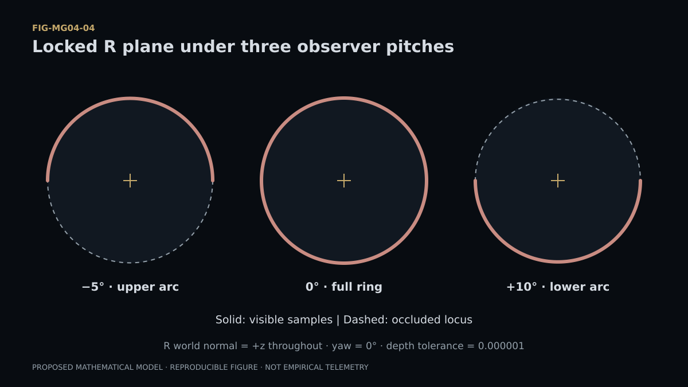
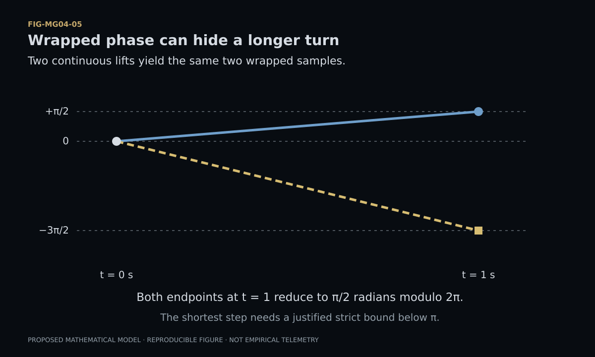
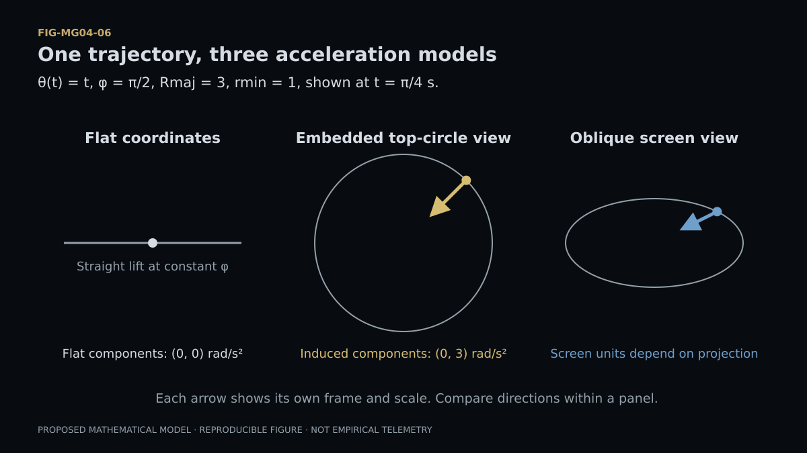

# MG-001 / GMG-A · Visual atlas v0.4

Review illustrations for the [working specification](../../specifications/MG-001_GMG-A_Dual_Instrument_Working_Specification_v0.4.md) and [mathematical notes](../MG-001_GMG-A_mathematical_notes_v0.4.md). Figure status appears below. The atlas uses generated geometry and documented simulation conditions.

| ID | Source equations or contract | Status |
| --- | --- | --- |
| FIG-MG04-01 | §3, TOR-01/02. Lattice quotient and sampled $X(\theta,\phi)$. | Mathematical illustration. Wireframe uses a fixed linear view and displays the grid without occlusion. |
| FIG-MG04-02 | §3, DIAL-01. Screen map $p_j$ with separate track radii and phase labels. | Proposed interface simulation. Status wording follows EF-001 and carries no numeric mapping. |
| FIG-MG04-03 | §4, ATT-01/NRM-01. First column of $A$ and $A\mathbf e_3$ at $\phi=0$. | Mathematical collision example within the trial adapter family. |
| FIG-MG04-04 | §4, GMG-02. $y_{\rm view}=\cos\eta\sin t$ and $z_{\rm view}=-\sin\eta\sin t$, with v0.2 tolerance and sampling. | Computed illustration of the preserved simulated crossing. Dashed hidden loci are explanatory overlays. |
| FIG-MG04-05 | §5, NUM-01. Two lifts with equal wrapped endpoints. | Calculated aliasing counterexample. |
| FIG-MG04-06 | §5, DYN-01. Constant angular velocity with induced and projected acceleration. | Calculated example with separate scales. |
| DG-01 | §2. $P_{\rm MG}$, $P_{\rm GMG}$ and assessment boundary. | Mermaid flowchart. Proposed paths for independent simulation and qualitative evidence. |
| DG-02 | §4. Apply $C$, clip depth, project. | Mermaid sequence. Existing projection behavior summarized as a read-only interaction. |
| DG-03 | [Gate A contract](../MG-001_GMG-A_gate_a_contract_v0.4.md). Ring-local, world, observer, and independent status path. | Mermaid flowchart. Proposed simulation path, preserved R, and separate observer aim. |
| DG-04 | [Gate A contract](../MG-001_GMG-A_gate_a_contract_v0.4.md). Assessment structure and label provenance. | Mermaid sequence. Fixture behavior and rejected inputs. |

## FIG-MG04-01 · Quotient and embedding



The horizontal coordinate is $\theta$ and the vertical coordinate is $\phi$. The wireframe samples the embedding with $R_{\rm maj}=2.15$ and $r_{\rm min}=0.72$ in arbitrary units. Each highlighted curve varies one phase while holding the other fixed.

## FIG-MG04-02 · Two tracks, one selected channel



Simulation phases are $\theta=1.02$ and $\phi=4.62$ radians. Track radii are 210 and 135 SVG units. Angles increase clockwise from the top. Marker shape and track radius distinguish the phase variables independently of the Y channel color.

## FIG-MG04-03 · Normal collision



The labeled rays 1–5 use $\theta=0,0.7,1.6,2.7,4.4$ radians at common $\phi=0$. Their first-column directions differ and their derived normal is the same vector $(0,0,1)$. This is one example of the pole fiber.

## FIG-MG04-04 · Observer-dependent clipping



Yaw is fixed at zero. World pose and inter-plane relationships are held constant. Compare the [observed v0.2 screenshots](../../snapshots/reference-plane-crossing/) and [transition regression](../../tests/reference-plane-transition.test.mjs).

## FIG-MG04-05 · Sampling and aliasing



The solid and dashed lines are continuous paths consistent with the same pair of wrapped samples. A strict bound on the step can exclude the longer lift. Without a bound both paths remain candidates.

## FIG-MG04-06 · Derivative frames



For $\theta(t)=t$ with time in seconds and $\phi(t)=\pi/2$, the flat acceleration vanishes. At the top of the embedded torus, the ambient inward acceleration also lies in the tangent plane, with induced angular components $(0,3)$ in radians per second squared for $R_{\rm maj}=3$ and $r_{\rm min}=1$. The screen panel represents a centered orthographic view tilted by $60^\circ$ about the horizontal axis. Centering absorbs the constant screen offset from elevation. Arrow lengths are illustrative time-scaled displacements within each panel.

The [preserved v0.2 reference SVG](../../assets/gmg-a-reference-pose-v0.2.svg) remains the source for existing spatial appearance. DG-03 records the frame and reticle boundaries for future work. An annotated reticle scene and optional twisted-fiber visual are deferred until their demonstration modes are specified.

## Reproduce

From the repository root, run the following with the repository's Node.js 22 baseline.

```sh
node scripts/generate-mathematical-figures.mjs
node scripts/generate-mathematical-figures.mjs --check
npm ci --ignore-scripts
npm run check
```

The generator and its [math helpers](../../scripts/v04-math.mjs) are the editable sources for the standalone SVGs. The generator formats sampled polyline coordinates to two decimal places and uses no runtime network resources. The SVGs include view boxes, titles and descriptions. Markdown captions provide the same conclusions when text inside the SVG is too small to comfortably read. See GitHub's [math formatting](https://docs.github.com/en/get-started/writing-on-github/working-with-advanced-formatting/writing-mathematical-expressions) and [Mermaid preview guidance](https://docs.github.com/en/get-started/writing-on-github/working-with-advanced-formatting/creating-diagrams).
