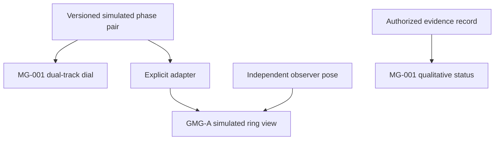
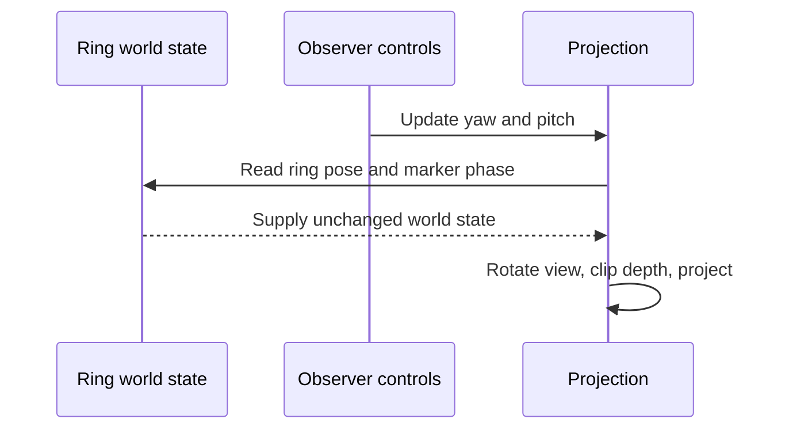

# MG-001 / GMG-A — Dual-Instrument Architecture

**Ascendancy Systems · Infotech**

**Revision** Working Draft v0.4 · 2026-11-20

**Authority** Experimental design proposal for review. Adapter, dial, derivatives, and transport are simulation designs pending ratification.

**MG-001 orients. GMG-A describes.** MG-001 remains the registered public orientation instrument. GMG-A is its experimental spatial and perceptual assembly. They can present different views of a common, versioned state while retaining separate geometric responsibilities and the existing source authority.

[Mathematical notes and proofs](../docs/MG-001_GMG-A_mathematical_notes_v0.4.md) · [Visual atlas and diagram registry](../docs/visual-atlas/v0.4.md) · [Gate A state and verification contract](../docs/MG-001_GMG-A_gate_a_contract_v0.4.md)

## 1. Source baseline and review changes

| Source | Role |
| --- | --- |
| [Dual-instrument v0.3](./MG-001_GMG-A_Dual_Instrument_Working_Specification_v0.3.md) | Historical working draft and baseline for the candidate models |
| [Spatial v0.2](./GMG-A_spatial_perceptual_relational_specification_working_draft_v0.2.md) · [Geometry](../src/geometry.mjs) · [Pose](../config/gmg-a-reference-pose-v0.2.json) · [Tests](../tests/) | Preserved spatial design, executable conventions, and simulation fixtures |
| [MG-001 operational record](https://github.com/Ascendancy-Systems/.github/blob/c7401e3c7b5f0033a86566a74d8e3308d146fee6/profile/META-GAUGE.md) · [Authorized EF-001 signal](https://github.com/Ascendancy-Systems/.github/blob/c7401e3c7b5f0033a86566a74d8e3308d146fee6/profile/signals/meta-gauge-mg-001.json) | Qualitative operational authority, at the reviewed organizational revision |
| [Artifact provenance](../docs/artifact-provenance.md) | Original GMG-A v0.1 prototype, specification, and archive are pending recovery. Historical formulas repeated in the notes are transcribed from v0.3 Appendix A. |

> [!NOTE]
> The spatial v0.2 executable and reference pose govern the existing simulation. The v0.4 model claims apply under the assumptions stated here. This revision is additive.

| Review change | Disposition |
| --- | --- |
| RC-01 · v0.3 called the candidate adapter non-invertible | Distinguish $A$, invertible onto its restricted image, from the many-to-one normal, plane, and potentially lossy display. The rotation formula is carried forward. |
| RC-02 · Dial zero and sense were unspecified | Keep the mathematical circle and explicitly convert to twelve o’clock / clockwise screen coordinates for the proposed dial. |
| RC-03 · Acceleration and twist required additional structure | Keep the flat angular connection as default. Derive the optional induced-metric case and declare a flat transport rule for the optional line bundle. |
| RC-04 · A visible arc “flip” and shortest-arc estimate require qualifications | Derive the camera-dependent visibility inequality including the tolerance band. State the strict sampling bound and the half-turn ambiguity. |
| RC-05 · Gate A follow-up | Specify independent simulation, assessment, and viewer records. Reject missing numerics and test supported interval failures. Retain the published v0.2 pose convention. |

## 2. Instrument boundaries and conventions

Define $S$ as a versioned envelope with independent simulation and assessment snapshots and explicit viewer state. Within the assessment snapshot, each register is a qualitative reading or is unavailable with a reason. A single view can present a simulation beside an assessment. Let $C$ be the independent observer pose. The views are $I_{\rm dial}=P_{\rm MG}(S)$ and $I_{\rm spatial}=P_{\rm GMG}(S,C)$, with the latter using a versioned adapter only for an eligible simulated channel. Selection can synchronize the two views as interaction state. Selection, camera orbit, reticle movement, and easing leave the simulation and assessment snapshots intact. The [Gate A contract](../docs/MG-001_GMG-A_gate_a_contract_v0.4.md) specifies the trial envelope and its failure cases.

**DG-01 · View and evidence paths.** Arrows indicate permitted information flow. The qualitative path ends in a status display.

| Symbol or identity | Convention |
| --- | --- |
| $\theta,\phi$ | Independent phase classes modulo $2\pi$. Equations use radians. Time derivatives use seconds only when the time base is known to be seconds. |
| $R_{\rm maj},r_{\rm min}$ | Major and minor embedding radii, with $R_{\rm maj}>r_{\rm min}>0$. These rename v0.3's $R,r$. |
| R / Y / B / G | Persistent ring IDs. R is the locked red Reference in the fixture. Yellow, Blue, and Green have independent poses. Channel IDs may label proposed simulations. |
| $Q_i,\varphi_m,C$ | Ring-local to world attitude, marker phase, and world to observer rotation. v0.2 pose inputs are in degrees and converted before evaluation. |
| $\mathbf e_1,\mathbf e_2,\mathbf e_3$ | Standard basis in a right-handed frame. Matrices act on columns, with the rightmost factor applied first. |

The spatial v0.2 language distinguishes world, instrument, ring-local, observer, and target frames. In the reference fixture the locked R plane is the world $xy$ plane. The ring phase origin is local $+\mathbf e_1$, positive toward $+\mathbf e_2$. This origin and the dial's proposed screen origin serve different frames. The dial's red zero cue carries no movable R ring state. Ring IDs are independent of the four MG-001 assessment registers.

## 3. Candidate state and dial

**TOR-01 · Quotient.** For simulation take $S^1=\{z\in\mathbb C:|z|=1\}$ and

$$
T^2=S^1\times S^1\cong\mathbb R^2/(2\pi\mathbb Z)^2,\qquad x(t)=[\theta(t),\phi(t)].
$$

The quotient topology identifies opposite edges of a square by translation. Each coordinate may cross its seam continuously as a circle-valued phase. The torus has fundamental group $\mathbb Z^2$, whereas the disk and sphere are simply connected. The dial face serves as a carrier for a pair of indicators.

**TOR-02 · Ring torus.** Set $h(\phi)=R_{\rm maj}+r_{\rm min}\cos\phi$. The optional embedding and its Euclidean induced metric are

$$
X(\theta,\phi)=(h\cos\theta,h\sin\theta,r_{\rm min}\sin\phi),
\qquad g=h^2\,d\theta^2+r_{\rm min}^2\,d\phi^2.
$$

The derivatives are orthogonal and have lengths $h$ and $r_{\rm min}$. The induced metric measures surface lengths for this particular embedding. The base topology alone supplies neither this metric nor physical meanings for the cycles.

**DIAL-01 · Two-track recovery.** The inherited mathematical indicator is $D_j=c+\rho_j(\cos j,\sin j)$ in a right/up frame for $j\in\{\theta,\phi\}$. The proposed screen convention uses a right/down frame, zero at twelve o’clock, and positive angles clockwise:

$$
p_j=c+\rho_j(\sin j,-\cos j),\qquad
j=\operatorname{atan2}(p_{j,x}-c_x,-(p_{j,y}-c_y))\pmod{2\pi},
\qquad 0<\rho_\phi<\rho_\theta.
$$

The inverse assumes a known center, labeled tracks, and an ideal nonzero-radius position for each. The ordered pair of complete tracks recovers the state. A conventional single continuous hand cannot encode the full torus injectively. Occlusion, clipping, pixel rounding and missing indicators weaken practical recovery. With Euclidean position error at most $\delta<\rho_j$, a calibrated track has angular error at most $\arcsin(\delta/\rho_j)$ (see notes).

## 4. Spatial assembly and proposed adapter

**GMG-01 · Existing geometry.** For stored ring angles $(\alpha,\beta,\gamma)$ and observer yaw/pitch $(\psi,\eta)$, the v0.2 executable uses

$$
\begin{aligned}
Q_i&=R_z(\gamma_i)R_y(\beta_i)R_x(\alpha_i),&
\mathbf p_i(t)&=Q_i(\cos t,\sin t,0)^\mathsf T,\quad \mathbf n_i=Q_i\mathbf e_3,\\
C&=R_x(-\eta)R_y(-\psi),&
(u,v)&=(c_x+s(C\mathbf p_i)_x,c_y-s(C\mathbf p_i)_y).
\end{aligned}
$$

Here $t$ denotes circle phase, not the time coordinate in §5. A ring marker samples $t=\varphi_m$. The renderer keeps samples with $z_{\rm view}\ge-\varepsilon$, with $\varepsilon=10^{-6}$ and 360 intervals in the fixture. The acute angle between unoriented planes is $\alpha_{i,R}=\arccos|\mathbf n_i\cdot\mathbf n_R|$ in radians, with the executable clamping the cosine and returning degrees. A common rotation preserves the dot product because $C^\mathsf T C=I$. It can change visible markers, screen positions, and depth.

**GMG-02 · Red visibility.** For R at the fixture attitude $I$ and yaw zero, $y_{\rm view}=\cos\eta\,\sin t$ and $z_{\rm view}=-\sin\eta\,\sin t$. At $-5^\circ$ the near side is upper in the screen image, and at $+10^\circ$ it is lower, up to the tolerance band. At exactly zero pitch all red samples pass the test. R's world normal remains $\mathbf e_3$. This accounts for the paired v0.2 screenshots without changing the world plane or invoking bundle transport.

**DG-02 · Camera update.** The sequence describes projection while the world-space ring state is held fixed.

The eight-point reference core marks projected origin. The movable observer reticle is distinct. Free aim uses the front-hemisphere inverse when a valid screen point is supplied. World- and ring-locked targets, where implemented later, retain an explicit target identity and attachment frame. Projected crossings alone are insufficient to establish a world intersection. Compare remains subject to target and frame validation. Steer / Target remains reserved.

**ATT-01 / NRM-01 · Adapter trial.** Reserve this mapping for simulation of a selected Y/B/G channel, with no coupling to locked R or EF-001:

$$
A(\theta,\phi)=R_z(\theta)R_x(\phi),\qquad
\mathbf n(\theta,\phi)=A(\theta,\phi)\mathbf e_3
=(\sin\theta\sin\phi,-\cos\theta\sin\phi,\cos\phi)^\mathsf T.
$$

The full matrix preserves both phases within its image. $\mathbf n$ is generically two-to-one, has a full circle of preimages at each pole, and loses rank there. Near a pole its sensitivity to $\theta$ scales as $|\sin\phi|$. An unoriented plane identifies $\mathbf n$ with $-\mathbf n$ and loses more information. Full attitude alone leaves the independent local marker phase unspecified.

Why the full attitude is recoverable but its normal is ambiguous

Using one-based matrix indices, the pairs $(A_{11},A_{21})=(\cos\theta,\sin\theta)$ and $(A_{33},A_{32})=(\cos\phi,\sin\phi)$ invert by two calls to atan2, modulo $2\pi$. All matrices in the image satisfy $A_{31}=0$. For example $R_y(\pi/2)$ lies outside it.

The normal obeys $\mathbf n(\theta+\pi,-\phi)=\mathbf n(\theta,\phi)$. At $\phi=0$ it is $\mathbf e_3$ for every $\theta$. The two derivative columns are orthogonal and have norms $|\sin\phi|$ and $1$. Their rank is two off the poles and one at $\phi=0,\pi$.

## 5. Dynamics and sampling

For a $C^2$ state path use continuous local lifts for the radians. The **flat product connection** descends through deck translations and remains the experimental default. The coordinate basis defines velocity and flat covariant acceleration:

$$
\dot x=\dot\theta\,\partial_\theta+\dot\phi\,\partial_\phi,\qquad
a_{\rm flat}=\ddot\theta\,\partial_\theta+\ddot\phi\,\partial_\phi.
$$

On the optional embedded surface the **induced-metric covariant acceleration** has components

$$
a_g^\theta=\ddot\theta-\frac{2r_{\rm min}\sin\phi}{h}\dot\theta\dot\phi,
\qquad a_g^\phi=\ddot\phi+\frac{h\sin\phi}{r_{\rm min}}\dot\theta^2.
$$

If $\phi=\pi/2$ and $\theta=\omega t$, the flat acceleration vanishes and $a_g^\phi=R_{\rm maj}\omega^2/r_{\rm min}$. The ambient derivative $d^2X/dt^2$ can also have a normal component. The induced acceleration is its tangential part written in the tangent basis. For a world path $\mathbf p(t)$ and fixed affine screen map with linear part $L$, the screen velocity is $L(C\dot{\mathbf p}+\dot C\mathbf p)$ and the second derivative is $L(C\ddot{\mathbf p}+2\dot C\dot{\mathbf p}+\ddot C\mathbf p)$. Varying screen scale or center adds its own terms. A moving camera can thus produce apparent motion for a fixed world point.

**NUM-01 · Wrapped samples.** For increasing timestamps, define

$$
\Delta\theta_k=\operatorname{atan2}(\sin(\theta_k-\theta_{k-1}),\cos(\theta_k-\theta_{k-1})),
\qquad
\widehat{\dot\theta}_k=\frac{\Delta\theta_k}{t_k-t_{k-1}}.
$$

Apply the same rule to $\phi$. With a justified continuous rate bound $|\dot\theta|\le\Omega$ and $\Omega\Delta t<\pi$, the true lifted step is the unique shortest increment. The estimator is an interval average. At equality the two half-turn directions can agree in the samples. With no bound, $+\pi/2$ and $-3\pi/2$ give identical endpoints. The 350° to 10° example gives +20° only under the relevant shortest-step assumption. With uncertain angles require a margin for endpoint error, or flag the interval. Invalid timestamps and unbounded gaps suppress derived values. Acceleration requires additional valid samples and a declared differencing rule.

Position / inspection reports a feature and frame. D1 reports a declared tangent or velocity. D2 requires the connection or frame and a valid time basis. Trace uses finite, time-labeled samples and visibly breaks at gaps. Derivative reticles default off. Displayed lengths require scales, clipping disclosure, and a numeric or textual equivalent. Label camera-induced motion as apparent/view motion.

## 6. Optional twisted transport and recursive evaluation

**TWIST-01 · Simulated auxiliary bundle, default off.** Use the real line bundle with identifications

$$
(\theta+2\pi,\phi,u)\sim(\theta,\phi,-u),\qquad
(\theta,\phi+2\pi,u)\sim(\theta,\phi,u).
$$

Lift a base path to $\mathbb R^2$ and keep the covering fiber coordinate $u$ constant. For a closed path of winding $(m,n)$, comparison in the initial fiber trivialization gives $(-1)^m u$. One $\theta$ circuit reverses the fiber sign and two restore it. The base torus stays orientable. With twist off, use the trivial line with identity transport. Any use requires a visible mode and frame label.

**REC-01 · Perturbation.** For a differentiable state update $x_{k+1}=F(x_k,u_k;\lambda)$ with inputs and parameters fixed during variation, a tangent perturbation obeys $\delta x_{k+1}=D_x F(x_k,u_k;\lambda)\delta x_k$. This is the v0.3 recursion with $\delta x$ replacing its overloaded $v$. An operational velocity needs temporal observations and an approved estimator. A translating phase update can have nonzero mean velocity while the zero perturbation remains zero.

**CAL-01 · Governed calibration, pending.** Specify a reference target, frozen loss and test split, baseline, uncertainty, admissible parameter updates, and approval criteria before evaluation. Report errors and rejected cases, including missing data and aliasing. Updating a candidate model requires versioning, an auditable comparison, and authorization before use. An iteration of $F$ supplies no evidence of improved calibration.

## 7. Evidence and state requirements

> [!IMPORTANT]
> Render qualitative evidence as an identified status with its scope, provenance, and limitations. EF-001 and unassessed registers supply no phase, magnitude, velocity, score, or spatial ring transformation.

| MG-001 register | Reviewed source reading | Scope or limiting factor |
| --- | --- | --- |
| Constitutional North | Unassessed | Bearing reference is unestablished. |
| Epistemic Fix | Provisionally Supported (EF-001) | Manual comparison of one public research-orientation sentence against two internal working references. Evidence is private, authority unverified, public verification pending, display authority only. Assessed 2026-11-20. |
| Continuity & Drift | Unassessed | EF-001 supplies no longitudinal comparison. |
| Dependency Readiness | Unassessed | Blocker inventory is unvalidated. |

The operational MG-001 v0.2 pipeline renders source-backed labels. Its geometry is unchanged by EF-001. Each future reading needs a bounded subject, source and assessment method, version and authority, effective or review time, validation, limitations, and explicit freshness/failure behavior. A proposed record must carry mode, model/mapping ID, channel ID, units, frame and time basis when applicable, validity and provenance. Simulated records carry simulation provenance. Approved categories use their source IDs and text. Missing numeric values are null with a reason. Zero is reserved for a valid numeric observation. Keep the evidence snapshot, core state, selection and viewer state independently identifiable.

Proposed desktop views are side by side and stack on narrow devices. Show the selected channel's paired pointers, a distinct zero cue, and a separate status window. Keep unselected marks compact and labeled. Preserve Void and neutrals, restrained copper/brass and rare gold, and the fixture's R/Y/B/G identities. Provide keyboard, touch, reduced-motion and non-color cues before commissioning. Use the same approved serialized state and mapping for any eventual public snapshot and corresponding live view.

## 8. Traceability and acceptance

| Claim or gate | Required verification | Disposition |
| --- | --- | --- |
| TOR-01/02, DIAL-01 | Quotient/embedding proof, metric via differential, two-phase round trip and zero/quarter-turn convention | Conditional math with numerical regressions |
| ATT-01, NRM-01 | Matrix inverse, non-surjectivity, normal collision and singular values, finite-difference Jacobian | Conditional math with numerical regressions |
| GMG-01/02 | Match preserved fixture/tests. Check angles, markers, depth tolerance and pitch transition | Existing simulation, additional analytical explanation |
| DYN-01, NUM-01, TWIST-01, REC-01 | Counterexamples, declared connection/sample/transport laws, numerical checks | Model-only verification |
| CAL-01, SEM-01 | Authorized measurement definition, independent evaluation, uncertainty and approved semantics | Open |

- [ ] Review equations, proof assumptions, and source traceability. Run the current repository checks and reproduce the atlas.
- [ ] Gate B · Build an isolated dual-view simulation and test selection invariance, explicit adapter identity, accessible controls, and static/live agreement.
- [ ] Gate C · Validate trace and D1/D2 reticles with valid trajectories, time basis, uncertainty, and visible apparent-motion labeling.
- [ ] Gate D · Pilot one justified reading with freshness and missing-value behavior. Validate the measurement method before introducing numbers.
- [ ] Gate E · Require perceptual and accessibility review, archival continuity, and explicit public release approval.

Gate A is the mathematical and documentation review in this revision. The [verification matrix](../docs/MG-001_GMG-A_gate_a_contract_v0.4.md#acceptance-matrix) identifies executable checks and remaining review decisions. Spatial v0.2's target lock, comparison, relational scene, and commissioning gates remain applicable to later implementation.

### Open hypotheses and decisions

Two actual periodic research variables and a valid research-to-phase map remain unidentified (SEM-01). Full-attitude, plane-only, and marker coupling need an explicit choice and validation. The dial red cue and any separate registered reference need distinct roles. The default flat connection is a simulation choice. Operational cadence, rates, error tolerances and reticle scales lack validated values. Twisted transport has no established research interpretation. Calibration benefit and perceptual legibility require evaluation. Nested gimbals, spherical region shading from 3D intersections, target steering, and publication remain separate design decisions. The historical terms **Proper, Anti, Anmti, Amnti, Anmnti** remain semantically open. **Amnmti** is the historically absent form. The earlier **True** label has no assumed equivalence to Proper.
